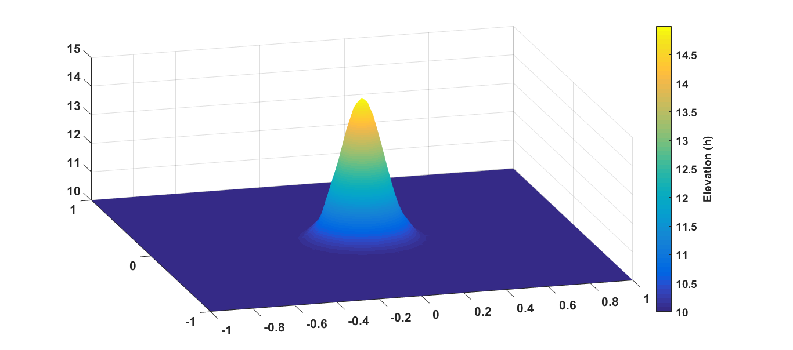
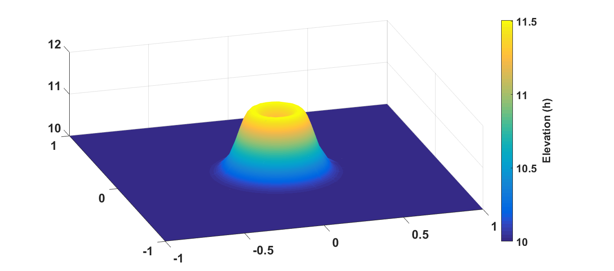
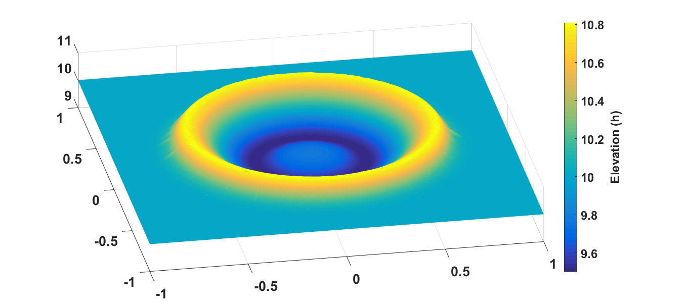

# DG-approach-for-SWEs
In this work, we designed a DG approach to solve the 2D shallow water equations
The approach of the DG method envisaged uses 1D and 2D auxiliary basis polynomials defined respectively on [−1, 1] and Tref, allowing for a considerable improvement in the efficiency of the computation of the local matrices (expressed in terms of a few constant matrices) appearing in the discretisation, and to bring out the hp -adaptivity of the method in a more pronounced way.

We rewrite the local matrices of the DG semi-discrete equations in terms of a global template. To that end, we used some auxiliary basis polynomials based on the 1D and 2D Jacobi polynomials. Furthermore, we used an unstructured triangulation mesh in our discretization. The validation of our approach is constructed by computing the solution of the shallow water equations with a Gaussian pulse as the initial condition and reflecting boundary conditions.

This work was done between February and June 2020 for my Master's thesis at AIMS - Rwanda.

The plots belows show a 3D view of the solution of the resolved shallow water equations he solution at times t = 0; 10^−2 ; 5 × 10^−2 .

